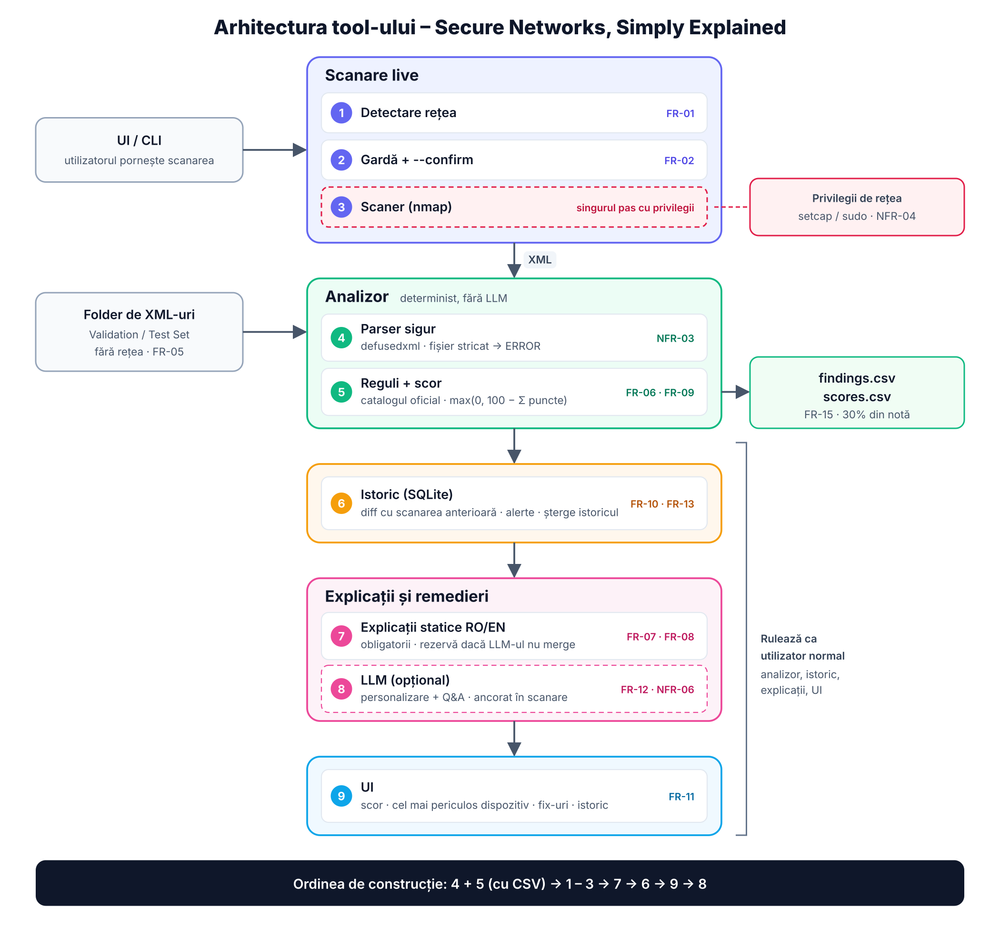

# Smarthack: Secure Networks, Simply Explained

**R Systems Hackathon 2026** · Team **Byte_me**

Most people have no idea what is connected to their Wi-Fi, which "doors" are open, or what that means.
This tool scans a small network **you own**, explains every risk in plain Romanian and English, tells
a non-technical person exactly how to fix it, gives a standard security score and keeps a history so
you can **prove** the network got safer after the fix.



---

## Contents

1. [What it does](#1-what-it-does)
2. [Architecture](#2-architecture)
3. [Repository layout](#3-repository-layout)
4. [Requirements](#4-requirements)
5. [Setup](#5-setup)
6. [Usage](#6-usage)
7. [How findings and the score are computed](#7-how-findings-and-the-score-are-computed)
8. [Explanations and the optional LLM](#8-explanations-and-the-optional-llm)
9. [History and change detection](#9-history-and-change-detection)
10. [Security and privacy](#10-security-and-privacy)
11. [Testing](#11-testing)
12. [The hotspot lab](#12-the-hotspot-lab)
13. [Ports used](#13-ports-used)
14. [Live checks for the jury](#14-live-checks-for-the-jury)
15. [Limitations](#15-limitations)
16. [Status](#16-status)

---

## 1. What it does

| Need | What the tool does | Requirement |
|---|---|---|
| **Visibility** | Detects the network automatically and lists every device: IP, masked MAC, vendor, hostname, device-type guess | FR-01, FR-03 |
| **Scope** | Refuses anything outside the connected subnet, refuses public IPs, needs explicit confirmation | FR-02 |
| **Ports** | Top 1,000 TCP ports + UDP 53, 123, 161, 1900, 5353, with service and version detection | FR-04 |
| **Analysis** | Applies the official finding catalog to nmap XML, including files analysed offline | FR-05, FR-06 |
| **Understanding** | Max 2 plain sentences per finding, in Romanian and English | FR-07 |
| **Action** | 1 to 5 ordered, concrete fix steps per finding | FR-08 |
| **Score** | Standard score `max(0, 100 − Σ points)` | FR-09 |
| **Proof** | Stores every scan, shows what changed and the score trend | FR-10, FR-13 |
| **UI** | Web page showing score, most dangerous device, fixes and history | FR-11 |
| **Grading output** | `findings.csv` + `scores.csv` for a whole folder in one command | FR-15 |
| **Assistant** (optional) | Answers questions using only evidence from the scan | FR-12 |

---

## 2. Architecture

The system has two halves with a single contract between them: **an nmap XML file**, the same format
the jury uses for the Validation and Test Sets.

```
┌──────────────────────── HOST (Linux, scanner laptop) ────────────────────────┐
│                                                                              │
│  scanner/agent.py   (normal user, listens on 127.0.0.1:8765 only)             │
│     ① detect.py   active interface, subnet, gateway, Wi-Fi name   FR-01       │
│     ② guard.py    allowlist + no public IPs + --confirm           FR-02       │
│        │                                                                     │
│        │  sudo -n /usr/local/sbin/netcheck-nmap <cidr>                        │
│        ▼                                                                     │
│     ③ netcheck-nmap   ROOT, re-checks the target, fixed nmap command          │
│        │                                                                     │
│        ▼  /var/lib/netcheck/scans/scan_<timestamp>.xml                        │
└────────┼─────────────────────────────────────────────────────────────────────┘
         │ read-only volume
┌────────▼──────────────── DOCKER (non-root user) ─────────────────────────────┐
│  backend/netcheck                                                            │
│     ④ analysis/parser.py    safe XML parsing                      NFR-03      │
│     ⑤ analysis/rules.py     catalog rules + score (no LLM)        FR-06/09    │
│        └──► analysis/export.py  findings.csv / scores.csv         FR-15       │
│     ⑥ history/              SQLite, diff by IP, alerts            FR-10/13    │
│     ⑦ explain/static.py     RO/EN texts, always available         FR-07/08    │
│     ⑧ explain/llm.py        optional, grounded in the scan        FR-12       │
│     ⑨ api/ + frontend/      FastAPI + React UI on 127.0.0.1:8001  FR-11       │
└──────────────────────────────────────────────────────────────────────────────┘
```

### Design decisions

1. **Analysis is pure and deterministic.** `backend/netcheck/analysis/` does not import the network
   code, the database or the LLM. The same XML always gives the same findings, severities and score
   (NFR-05), so the live re-run in front of the jury matches the uploaded results.
2. **Only one small file runs as root.** `netcheck-nmap` is installed outside the repository, owned by
   root, accepts a single argument (the subnet), checks it again and builds a fixed nmap command.
   `sudoers` allows *only this wrapper*, never `nmap` itself, because `sudo nmap --script …` would mean
   full root (NFR-04).
3. **Two independent checks of the scope.** The agent's guard and the root wrapper both verify that
   the target is private, at most /24 and inside the current network.
4. **The scanner runs on the host, not in Docker.** A container sees the Docker network, not the
   hotspot, so network detection and the guard would check the wrong subnet. The app container uses
   `network_mode: host` to reach the agent on `127.0.0.1`. Its web server also binds to `127.0.0.1`,
   so it is not visible on the hotspot.
5. **The catalog is data, not `if` statements.** `analysis/catalog.py` holds code → severity, points
   and services, so a rule can be corrected by changing one line.
6. **Texts live in YAML.** `explain/texts/ro.yaml` and `en.yaml` can be written and reviewed without
   touching code.
7. **The scan determines the facts.** The model selects evidence for the answer. Python renders
   those records and provides the built-in fallback when the model is unavailable.

### Two ways in

| Mode | Input | Needs network / root | Used for |
|---|---|---|---|
| **Live scan** | the network the laptop is connected to | yes, only for step ③ | the UI, the lab, history |
| **File analysis** | a folder of nmap XML files | no | Validation Set, Test Set, re-runs |

---

## 3. Repository layout

```
Smarthack/
├── README.md                  this file
├── SmartHack_Setup.md         existing distributed LLM setup (llama-server on the MSI)
├── docker-compose.yml         the app container (backend + built frontend)
├── .env.example               configuration names only, no values
├── .gitignore                 .env, .api_key, data/, input/ are never committed
│
├── scanner/                   HOST: the only part that touches the network
│   ├── agent.py                 CLI + localhost HTTP agent
│   ├── detect.py                FR-01, ignores VPN and Docker interfaces
│   ├── guard.py                 FR-02, bilingual refusals
│   ├── netcheck-nmap            root wrapper, fixed nmap command
│   ├── install.sh               one-time host setup (group + sudoers)
│   └── README.md
│
├── backend/                   DOCKER: analysis, history, explanations, API
│   ├── Dockerfile               builds the frontend and the backend into one image
│   ├── pyproject.toml
│   ├── netcheck/
│   │   ├── analysis/            parser, catalog, rules, versions, scoring, privacy, export
│   │   ├── history/             SQLite store, diff
│   │   ├── explain/             static texts (YAML) + optional LLM
│   │   ├── api/                 FastAPI routes + agent client
│   │   ├── cli.py               `netcheck analyze <folder>`
│   │   └── config.py            environment variables only
│   └── tests/
│       └── fixtures/            Validation Set + our lab scans
│
├── frontend/                  React + TypeScript (Vite)
│   └── src/  pages/ components/ i18n/ api/ styles/
│
├── lab/                       the hotspot lab (Docker targets + fake services)
├── data/                      local SQLite history (git-ignored)
├── input/                     Validation / Test Set folders to analyse (git-ignored)
└── docs/                      architecture, lab plan, technical summary, pitch, live checks
```

A file-by-file description is in [`docs/STRUCTURE.md`](docs/STRUCTURE.md).

---

## 4. Requirements

| Machine | Needs |
|---|---|
| **Scanner laptop** (MSI, Ubuntu) | Linux, Python 3.11+, `nmap`, `iproute2`, `iw`, `sudo`, Docker Engine + Compose |
| **Target laptop** (Mac) | Docker Desktop, Python 3 (lab only) |
| **Network** | One phone hotspot, WPA2/WPA3, named `RSH-<team>` |

The scanner laptop must be connected **only** to the hotspot while scanning.

---

## 5. Setup

### 5.1 Scanner (once, on the scanner laptop)

```bash
sudo EXTRA_TCP_PORTS=1883,2323,6379 ./scanner/install.sh    # extra ports are optional (lab services)
newgrp netcheck                                             # or log out and back in
python3 scanner/agent.py network                            # check the detected network
```

`install.sh` installs nmap, copies the wrapper to `/usr/local/sbin/netcheck-nmap` (owned by root),
creates `/var/lib/netcheck/scans`, the `netcheck` group and the sudoers rule
`%netcheck ALL=(root) NOPASSWD: /usr/local/sbin/netcheck-nmap`.

### 5.2 Configuration

```bash
cp .env.example .env      # optional: fill in LLM_BASE_URL to use the local llama-server
```

| Variable | Default | Purpose |
|---|---|---|
| `LLM_BASE_URL` | empty | OpenAI-compatible endpoint, e.g. `http://127.0.0.1:8080/v1`. Empty = built-in texts only |
| `LLM_API_KEY` | empty | only if the endpoint needs one; never committed |
| `LLM_MODEL` | empty | model name sent to the endpoint |
| `LLM_TIMEOUT` | `60` | seconds to wait for the LLM before showing the built-in text |
| `NETCHECK_AGENT_URL` | `http://127.0.0.1:8765` | where the app finds the scanner agent |
| `NETCHECK_LANG` | `ro` | default UI language |

### 5.3 Start

```bash
docker compose up -d --build            # app → http://127.0.0.1:8001
python3 scanner/agent.py serve          # scanner agent (normal user, separate terminal)
```

**Build the image before the event.** The build downloads base images, Python and npm packages.
At the venue the scanner laptop is only on the hotspot (no venue Wi-Fi, limited mobile data), so
run `docker compose build` at home, then check that `netcheck analyze` works with the network off.

---

## 6. Usage

### Analyse a folder of scan files (Validation / Test Set)

```bash
cp -r ~/Downloads/test_set input/test_set
docker compose run --rm app netcheck analyze /data/input/test_set --out /data/input/test_set/results
# → input/test_set/results/findings.csv and scores.csv
```

An unreadable file gets `ERROR` in `scores.csv`, and the other files are still processed.

### Live scan

From the UI: **Scan** → a dialog shows the Wi-Fi name, subnet and gateway plus the consent text →
**Confirm**.

From the terminal:

```bash
python3 scanner/agent.py network            # what will be scanned
python3 scanner/agent.py scan --confirm     # scan it (about 3–4 minutes on the lab)
```

### What the scan runs

```
nmap -sS -sU -sV --script http-title --max-rate 100 \
     -p T:<top 1000 TCP>[,extra],U:53,123,161,1900,5353 -oX <file> <subnet>
```

`--max-rate 100` respects the ≤ 100 packets/second rule.

---

## 7. How findings and the score are computed

These rules are applied by code only, never by an LLM, so the results are identical on every run.

1. Only ports in state **`open`**. `filtered`, `closed` and UDP `open|filtered` are ignored.
2. The decision uses the **service name** reported by nmap, not the port number. Telnet on 2323 is still Telnet.
3. HTTPS appears as `service name="http"` with `tunnel="ssl"`, so it is **not** `HTTP_ADMIN_CLEARTEXT`.
4. `HTTP_ADMIN_CLEARTEXT` needs plain HTTP **and** a page title containing login, admin, config, setup, router or settings.
5. `SMB_EXPOSED` is one finding per device: port 445 if open, otherwise 139.
6. `OUTDATED_SERVICE` is reported **in addition** to the service's own finding.
   Outdated: vsftpd 2.3.4, OpenSSH below 7.4, Apache httpd 2.2.x or older, IIS 7.5 or older, Samba 3.x or older.
7. `UNKNOWN_DEVICE`: no MAC vendor, no hostname, at least one open port. The port column is empty.

| Code | Severity | Points |
|---|---|---|
| TELNET_OPEN, RDP_EXPOSED, VNC_EXPOSED, DB_EXPOSED, CAMERA_STREAM_EXPOSED, OUTDATED_SERVICE | High | 20 |
| FTP_CLEARTEXT, HTTP_ADMIN_CLEARTEXT, SMB_EXPOSED, MQTT_EXPOSED, UPNP_EXPOSED, SNMP_EXPOSED | Medium | 10 |
| PRINTER_RAW_EXPOSED, UNKNOWN_DEVICE | Low | 5 |
| SSH_OPEN | Info | 0 |

**Score** = `max(0, 100 − sum of points)`.

CSV rows are sorted by file → IP (numeric) → port (numeric, empty last) → code, so the output is
byte-for-byte reproducible.

---

## 8. Explanations and the optional LLM

- **Built-in texts** (`backend/netcheck/explain/texts/*.yaml`): one explanation of at most two sentences
  and 1–5 fix steps per code, in Romanian and English, at roughly a 12-year-old reading level.
  Context variants exist where the code alone would mislead. For example, `rtsp` on a Mac is AirPlay, not a camera.
- The optional llama-server on the MSI selects relevant scan records. Python renders each selected
  device, endpoint, finding and score in the requested language. Device-specific explanations use a
  verified label with the original explanation and ordered fixes.
- An IP outside the current scan gets a local reply before the model is called. For in-scope
  questions, the model can select only IDs offered for that question. Unrecognised IDs, malformed
  replies and free-form claims fall back to built-in text. A question can still be ambiguous, so
  each returned statement identifies its device or endpoint. Simple score questions read the scan score directly.
- Model requests go directly to a numeric loopback address. The client normalises `localhost`
  to `127.0.0.1` and disables environment proxies and redirects.
- **Try it against the real model:** `docker compose run --rm app python -m netcheck.explain.smoke`

---

## 9. History and change detection

- Every scan is stored locally in SQLite (`data/netcheck.sqlite`), never sent anywhere.
- Two scans are compared **by IP address, not by MAC**. Phones and laptops randomise their MAC, and
  in the Validation Set the same router appears with different MACs before and after.
- The diff shows: new or removed devices, opened or closed ports, resolved and new findings, and the score trend.
- A new device or newly opened port since the previous scan raises an alert (FR-13).
- **Delete my history** wipes the local database in one click (NFR-02).

---

## 10. Security and privacy

| Requirement | How it is met |
|---|---|
| **NFR-01 Secrets** | Configuration only through environment variables; `.env` and `.api_key` are git-ignored. Checked live with `gitleaks detect` |
| **NFR-02 Privacy** | MAC addresses masked in all output (`50:C7:BF:xx:xx:xx`); history stored only locally; one-click delete |
| **NFR-03 Hostile input** | `defusedxml` (no external entities), file size limit, banners and titles treated as untrusted text and escaped in the UI |
| **NFR-04 Least privilege** | Only `netcheck-nmap` runs as root, and only during a scan. The agent, the API and the UI run as normal users; the container runs as a non-root user |
| **NFR-05 Determinism** | Findings and scores come from code only; dedicated test runs each file three times |
| **NFR-06 Grounded AI** | The LLM only sees scan evidence and never produces findings or scores |
| **Scope guardrail** | Explicit confirmation, connected subnet only, public and reserved ranges refused, VPN and Docker interfaces ignored, refused when the laptop is on more than one network (e.g. hotspot + venue cable), checked twice (agent + root wrapper) |
| **Local agent API** | Accepts only the app's own server-side client (Host `127.0.0.1`, no browser `Origin`, JSON only), so a web page cannot start a scan |

---

## 11. Testing

```bash
docker compose run --rm app pytest -q              # backend
python3 -m unittest discover -s scanner/tests      # scanner (stdlib only, never scans)
```

| Test | Checks |
|---|---|
| `test_validation.py` | Validation Set → exactly the 24 expected rows, no extra rows, all 8 scores |
| `test_rules.py` | Traps: `tunnel=ssl`, `filtered`, UDP `open|filtered`, SMB 139 + 445, `UNKNOWN_DEVICE`, version parsing |
| `test_parser.py` | Truncated file, XML entity attacks, oversized file |
| `test_history.py` | V6a → V6b shows 3 resolved findings although MACs changed |
| `test_lab.py` | Our lab: before → 0, after → 75 |
| `test_determinism.py` | Same file three times → identical output |
| `test_llm.py` | Grounding check, fallbacks, prompt injection, privacy, determinism of the LLM layer |
| `scanner/tests/test_scanner.py` | Guard refusals (public IP, venue subnet, no `--confirm`), two networks refused, root wrapper rule, agent rejects browser / wrong-Host requests |

---

## 12. The hotspot lab

Details: [`lab/README.md`](lab/README.md).

| Role | Device | IP |
|---|---|---|
| Gateway | iPhone hotspot `RSH-Byte_me` | 172.20.10.1 |
| Scanner | MSI (Ubuntu, nmap 7.98) | 172.20.10.9 |
| Target | MacBook (Docker Desktop) | 172.20.10.11 |

- **Targets:** Docker containers (Redis, Mosquitto 1.6, nginx "Router Admin Login"), fake Telnet
  and FTP banners (no real login or shell behind them), and real macOS sharing services.
- **Before / after:** 10 finding types and score **0** → after turning off Screen Sharing, File
  Sharing, Remote Login, AirPlay Receiver, the fake services and Redis, the score is **75**.

---

## 13. Ports used

| Port | Service | Machine | Listens on |
|---|---|---|---|
| 8001 | this app (API + UI) | scanner laptop | 127.0.0.1 |
| 8765 | scanner agent | scanner laptop | 127.0.0.1 |
| 8080 | llama-server (optional LLM) | MSI | 127.0.0.1 |
| 8000 | existing SmartHack chat API | MSI | 0.0.0.0 (see `SmartHack_Setup.md`) |

---

## 14. Live checks for the jury

| # | Check | How |
|---|---|---|
| 1 | Re-run one Test Set file | `netcheck analyze` on that file; output equals the upload |
| 2 | Most dangerous device + first fix | Dashboard, first screen |
| 3 | Explanations for 3 findings | Device page → finding card (RO/EN) |
| 4 | Guardrail | `agent.py scan --target 8.8.8.8 --confirm` and `--target <venue subnet>` → refused; without `--confirm` → refused |
| 5 | Broken file | Analyse `V7_broken.xml` → clear error, no crash |
| 6 | History before/after | History page: our lab, 0 → 75 |
| 7 | No secrets | `gitleaks detect --source .` |

---

## 15. Limitations

- The scanner host must be **Linux** (uses `ip`, `sudo`, Docker host networking). macOS and Windows hosts are not supported.
- **IPv4 only**, networks of **/24 or smaller**. Larger office networks are refused.
- The tool cannot know whether the user owns the network, only that the laptop is connected to it.
  The confirmation dialog states that only owned or authorised networks may be scanned.
- With nmap 7.98, the `mqtt-subscribe` script overwrites the service name on port 1883
  (`mosquitto version …` instead of `mqtt`), so `MQTT_EXPOSED` is not raised for that broker. The
  catalog is applied exactly as written rather than patched for this case.
- AirPlay (ports 5000 and 7000) is reported by nmap as `rtsp` and therefore counts as
  `CAMERA_STREAM_EXPOSED`; the explanation text says "audio/video stream" instead of "camera".
- On networks with many devices, a full scan may take longer than 5 minutes because of the 100 packets/second limit.

---

## 16. Status

| Part | State |
|---|---|
| Hotspot lab + before/after scans | done |
| Scanner: detection, guard, root wrapper, agent, installer | done |
| Analysis (parser, rules, score, CSV) | scaffold, next |
| Explanations RO/EN | scaffold |
| History + diff | scaffold |
| API + frontend | scaffold |
| Optional LLM (grounded personalisation + Q&A) | done, API wiring pending |
